
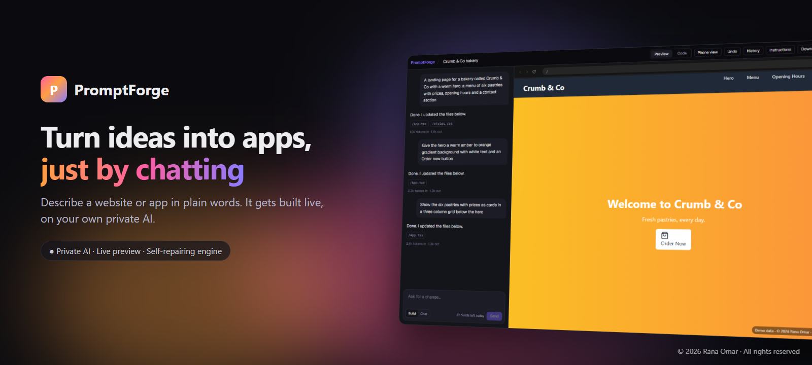

# PromptForge

**An AI app builder: describe a website or app in plain words, and watch it get built.** PromptForge writes the code, runs it live in the browser and keeps improving it as you chat. Everyone gets their own account and projects, and the AI runs on your own machine or server, so ideas and code never go to an outside AI company.

> **This is a product showcase.** PromptForge and its source code are proprietary and are **not** included in this repository. See [License](#license).

**Showcase website:** https://rana537omar.github.io/promptforge/

## How it works

1. **Describe it.** Type an idea such as "a booking page for my yoga studio", or start from a template.
2. **Watch it appear.** The code is written in front of you and runs in a live preview, on desktop and phone sizes.
3. **Refine by chatting.** Ask for one change at a time. Every version is saved, so nothing is ever lost.

## Features

### Building
- **Prompt to app**: React and Tailwind web apps from plain-language requests, written file by file while you watch.
- **Live preview** that runs in the browser, with a phone view and a built-in code editor for hand edits.
- **Build and Chat modes**: Chat answers questions and plans next steps without touching the app.
- **Enhance prompt** turns a short idea into a detailed brief, and six **templates** get you started.
- **Project instructions**: brand colours, tone and rules the AI follows on every request.

### A self-repairing engine
- After every build, PromptForge checks the code and fixes the mistakes AI models commonly make: missing packages, icons that don't exist, components that were referenced but never written, and navigation without a router.
- **Fix with AI**: when the preview hits an error, one click repairs it, usually instantly and without calling the AI at all.

### Safe to experiment
- **Version history**: undo the last change or restore any earlier version in one click.
- **Share** a project as a full-screen public link, without the builder or the chat.
- **Download** a standard React project that runs and hosts anywhere.

### A platform for many users
- Sign-up and login, with each account's projects kept private.
- A daily build allowance per account, shown in the account menu and the chat box.
- One small server with a built-in database: no external database or AI service to pay for.

### Private by design
- The AI is an open-source coding model running on your own hardware or GPU server.
- Nothing about your users' ideas or code is sent to a third-party AI provider.

## Screenshots

| | |
|---|---|
| 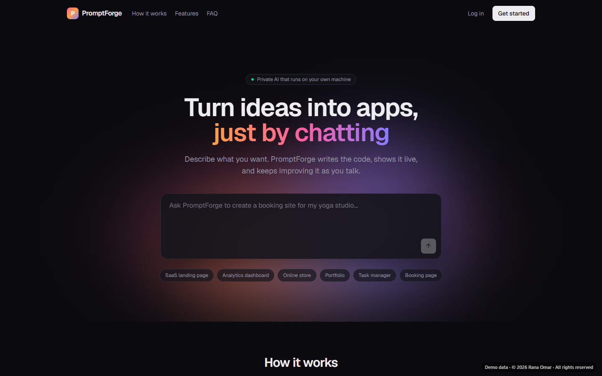 **Landing page**: describe an idea or pick a template. | 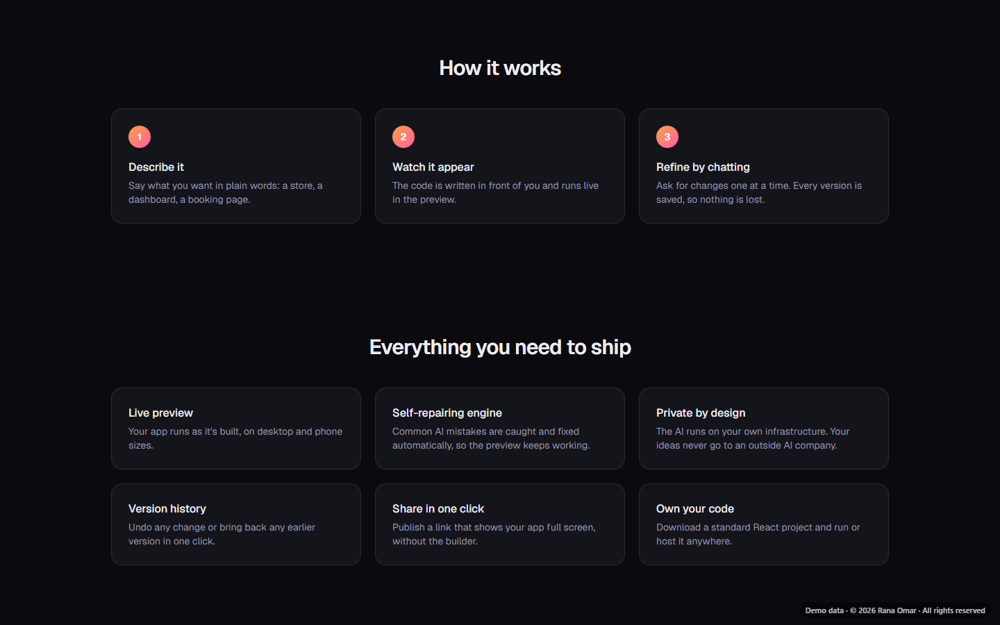 **How it works**, features and FAQ for new visitors. |
| 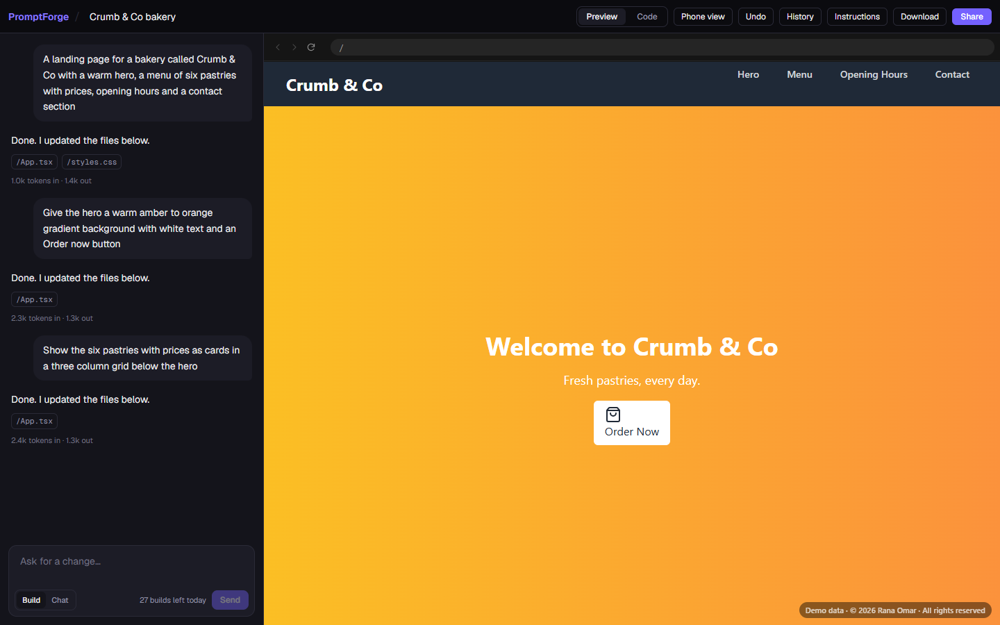 **Workspace**: chat on the left, the live app on the right. | 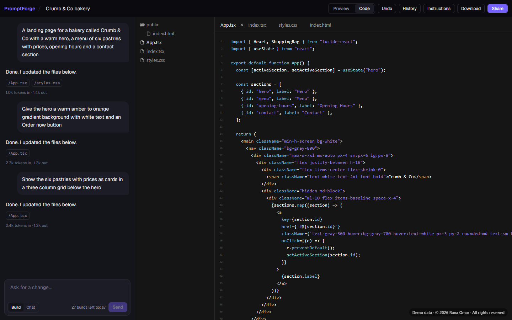 **Code view** with a file tree and editor. |
| 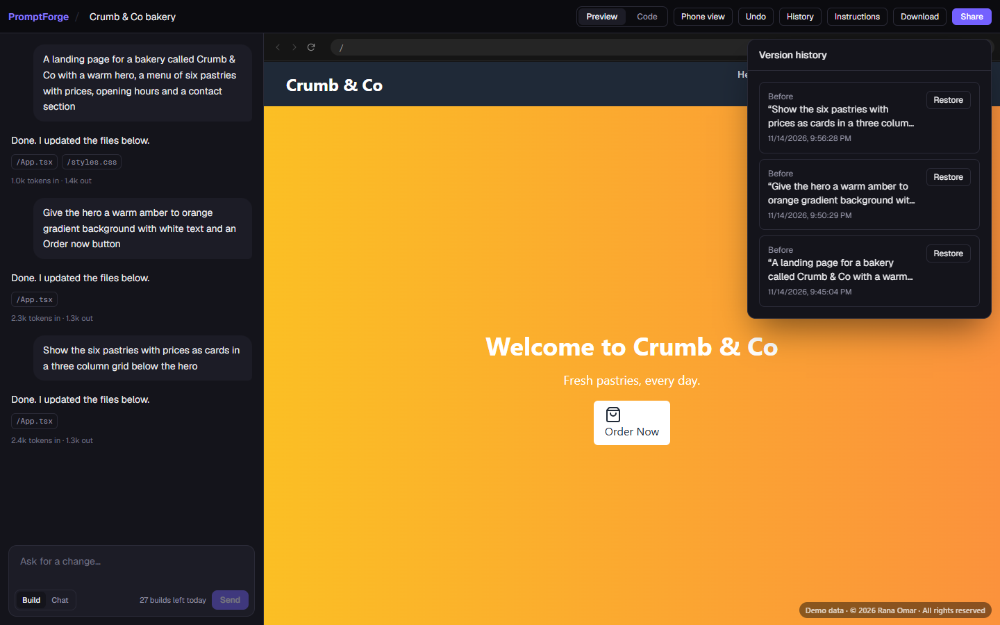 **Version history**: restore any earlier version. | 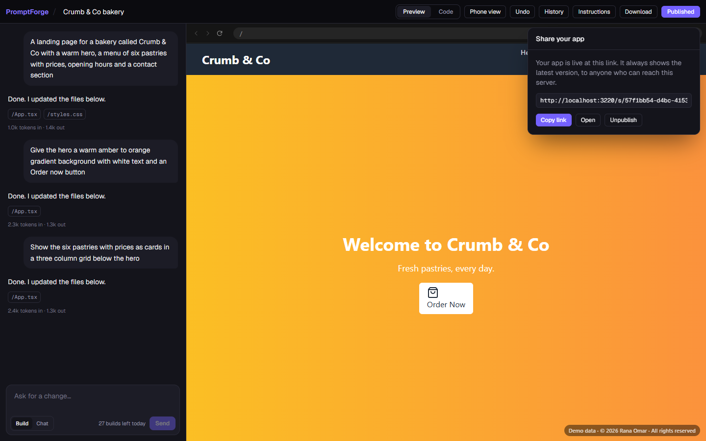 **Share** a public link in one click. |
| 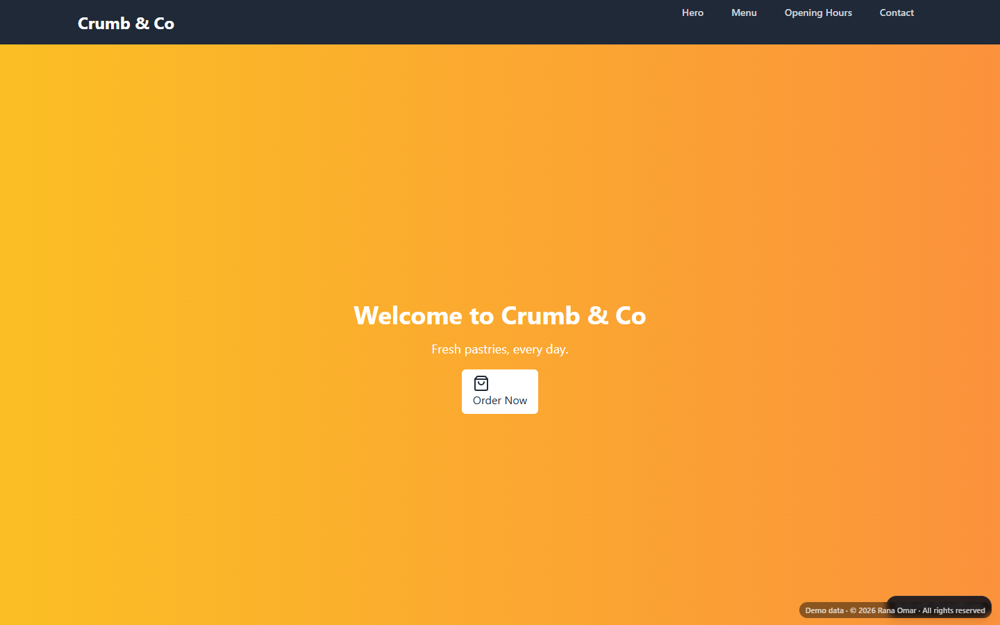 **A shared app**, full screen without the builder. | 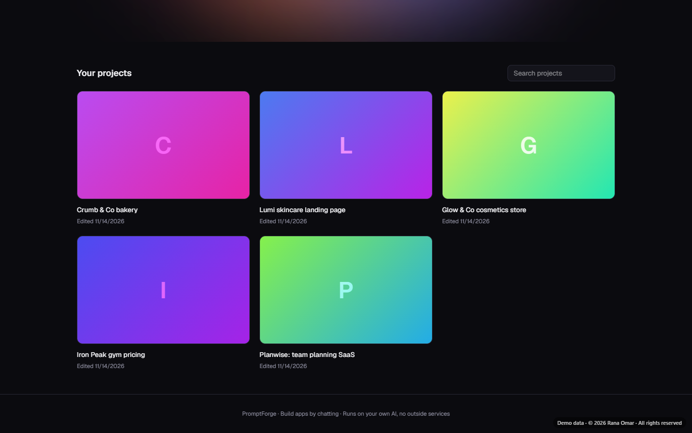 **Dashboard**: all of an account's projects. |
| 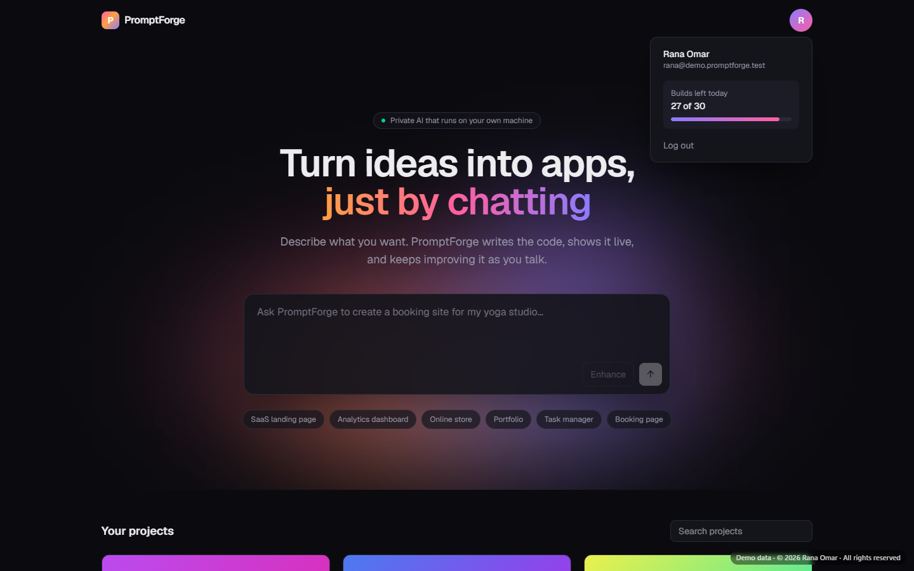 **Account menu** with the builds left today. | 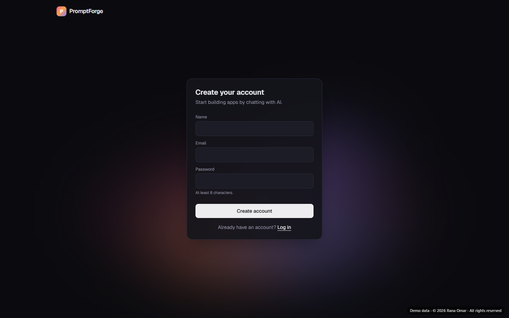 **Sign up** and start building. |

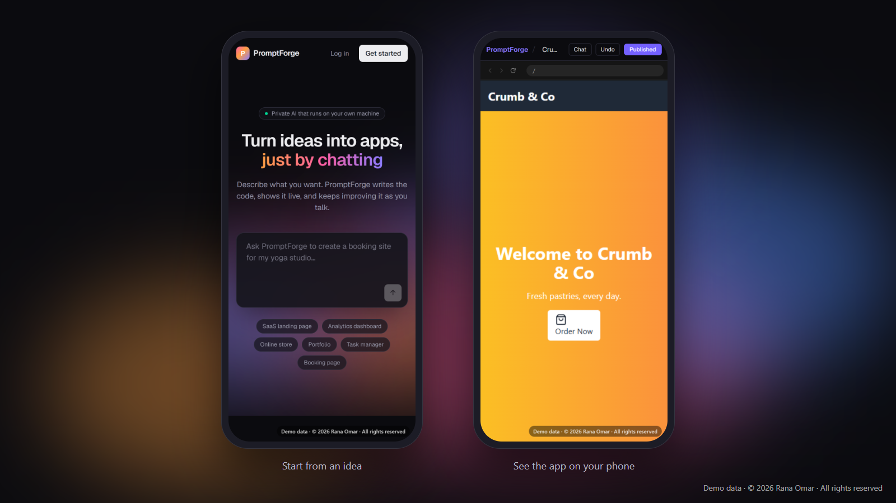

All names, projects and figures in these screenshots are demo data. The apps shown were built by PromptForge's own AI.

## Get the full system

Want PromptForge for your company or clients, a live demo, or the complete source code? Message me on WhatsApp: **+20 120 856 2225**.

## License

**Copyright © 2026 Rana Omar. All rights reserved.** The text, screenshots and images in this repository are shared for viewing only. No license is granted to copy, reuse, modify, republish or use them, or the PromptForge software they show, for any personal or commercial purpose. See [LICENSE](LICENSE).
